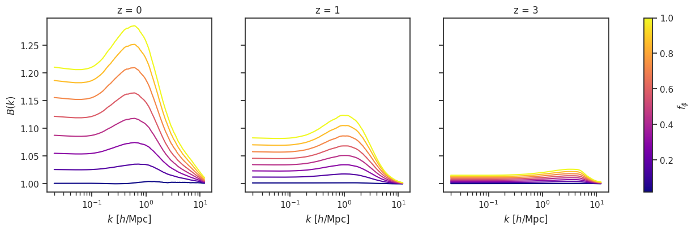
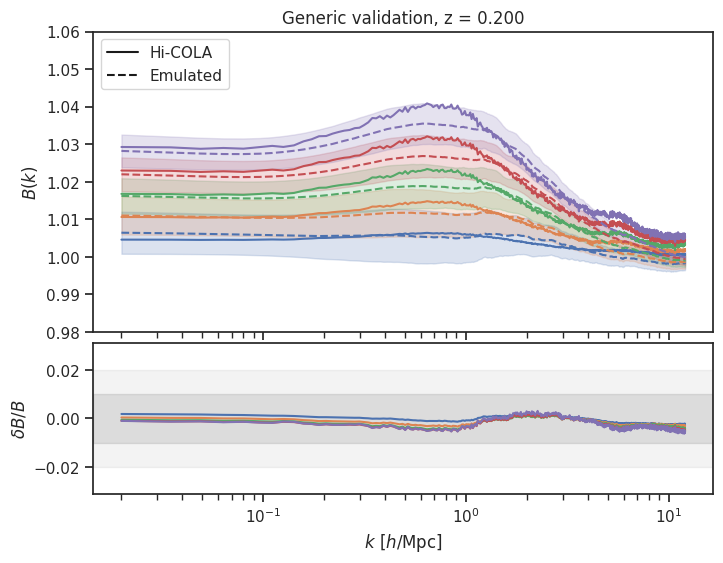
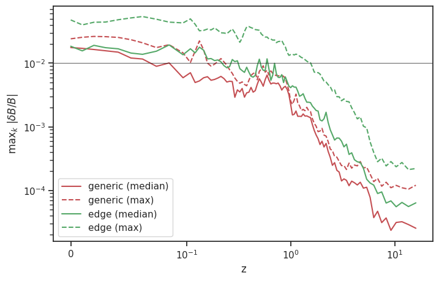

# CubicGalileonEmu

[](https://github.com/LSSTDESC/CubicGalileonEmu/actions/workflows/ci.yml)

> Gaussian-process emulator for the matter power spectrum boost factor $B(k, z)$ in the cubic Galileon modified-gravity model.

The emulator is trained on Hi-COLA simulations spanning five parameters
($\Omega_m$, $n_s$, $10^9 A_s$, $h$, $f_\phi$). For each training redshift snapshot, the boost
is compressed with PCA (keeping 99.9% of the variance) and the PCA weights are modelled with a
Gaussian process using [SEPIA](https://github.com/lanl/SEPIA). Predictions at intermediate
redshifts are linearly interpolated between neighbouring snapshots.

The pre-trained models ship with the package; no training is required.

## Installation

Requires Python 3.8–3.11 (the `scipy<=1.10.1` pin has no wheels for 3.12+).

```sh
git clone https://github.com/LSSTDESC/CubicGalileonEmu.git
cd CubicGalileonEmu
pip install .
```

SEPIA is installed automatically from its GitHub repository.

## Usage

The package has a single entry point, `emulate(params, z)`:

```python
from CubicGalileonEmu import emulate

# [Omega_m, n_s, 1e9 A_s, h, f_phi]
params = [0.31, 0.96, 2.1, 0.68, 0.5]

k, Bk_mean, Bk_std = emulate(params, z=0.5)

print(k.shape)        # (768,)    wavenumbers [h/Mpc]
print(Bk_mean.shape)  # (1, 768)  emulated boost B(k)
print(Bk_std.shape)   # (1, 768)  emulator standard deviation
```

Pass an `(n, 5)` array to emulate many cosmologies at once; each row of the output corresponds
to one parameter set:

```python
import numpy as np
from CubicGalileonEmu import emulate, PARAM_NAMES, PARAM_MIN, PARAM_MAX, Z_MIN, Z_MAX

print(PARAM_NAMES)               # ['Omega_m', 'n_s', '1e9 A_s', 'h', 'f_phi']
print(PARAM_MIN, PARAM_MAX)      # training box
print(Z_MIN, Z_MAX)              # 0.0 15.892

# Vary f_phi across its training range, other parameters at the centre of the box
params = np.tile(0.5 * (PARAM_MIN + PARAM_MAX), (8, 1))
params[:, 4] = np.linspace(PARAM_MIN[4], PARAM_MAX[4], 8)

k, Bk_mean, Bk_std = emulate(params, z=1.0)
print(Bk_mean.shape)             # (8, 768)
```

<p align="center">
  
</p>

### Valid inputs

| Input | Range | Outside the range |
|---|---|---|
| `z` | `Z_MIN`–`Z_MAX` (0 – 15.892) | `ValueError` |
| `params` | `PARAM_MIN`–`PARAM_MAX` (training box) | `UserWarning`, extrapolated result |

## Accuracy

Comparison with held-out Hi-COLA simulations, including redshifts that fall between training
snapshots (left: $z = 0.2$; right: worst-case fractional error over $k < 1.2\,h/$Mpc for every
validation cosmology and redshift). The "edge" set deliberately samples the boundary of the
training box.

<p align="center">
  
  
</p>

## Example notebook

[`examples/CubicGalileonEmu_demo.ipynb`](examples/CubicGalileonEmu_demo.ipynb) walks through
emulation, validation against the held-out simulations in `examples/data/`, sensitivity to each
parameter, and the emulator uncertainty across parameter space. It produces the figures above.

```sh
pip install '.[examples]'
cd examples && jupyter notebook CubicGalileonEmu_demo.ipynb
```

## Tests

```sh
pip install '.[test]'
pytest tests
```

The tests also execute the Python examples in this README. CI (GitHub Actions) runs them on
Python 3.9–3.11, builds the wheel and checks that all models and data are bundled, and executes
the example notebook.

## License

MIT, © LSST Dark Energy Science Collaboration (DESC) — see [LICENSE](LICENSE).
